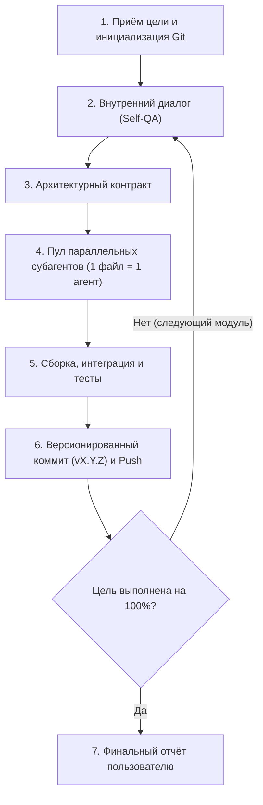

# GeminiAuto 🚀

> **Автономный оркестратор задач для Google Antigravity (`/agent`)**

[](https://antigravity.google)
[](https://github.com/VerlorenRise/GeminiAuto)
[](https://opensource.org/licenses/MIT)

**GeminiAuto** содержит скилл `/agent` — полностью автономный пайплайн разработки для ИИ-агента Antigravity. При получении высокоуровневой задачи оркестратор самостоятельно проектирует архитектуру, проводит саморефлексию (Self-QA), параллельно распределяет написание файлов между изолированными субагентами (по принципу **1 файл = 1 агент**), выполняет сборку и тестирование, автоматически устраняет ошибки и пушит версионированные коммиты (`v0.0.1+`).

---

## 🌟 Ключевые возможности

- 🤖 **100% Автономность (No Interruptions)**: агент не отвлекает вопросами и промежуточными подтверждениями, а доводит проект до 100% готовности.
- 🧠 **Внутренний диалог (Self-QA)**: глубокий анализ архитектуры, интерфейсов, граничных случаев и тестов перед написанием кода.
- 📐 **Архитектурный контракт**: строгая фиксация DTO, сигнатур методов и путей файлов перед передачей субагентам.
- ⚡ **Параллельные субагенты (1 файл = 1 агент)**: строгая изоляция файлов, исключающая конфликты при генерации кода.
- 🛠️ **Автономная сборка и самоисправление**: самостоятельный запуск сборщиков (Maven, Gradle, npm и др.), анализ стек-трейсов и исправление ошибок.
- 🏷️ **Автоматическое версионирование коммитов**: каждый логический шаг фиксируется в формате `vX.Y.Z: <описание>` с непрерывным инкрементом от `v0.0.1` до `v9.9.9`.

---

## 🔄 Жизненный цикл оркестратора



---

## 📂 Структура репозитория

```
GeminiAuto/
├── SKILL.md              # Корневой манифест скилла /agent
├── skills/
│   └── agent/
│       └── SKILL.md      # Копия для модульной структуры скиллов
├── LICENSE               # Лицензия MIT
└── README.md             # Документация и руководство
```

---

## 📥 Установка и использование

### Способ 1: Глобальный скилл пользователя
Скопируйте `SKILL.md` в вашу глобальную директорию скиллов Antigravity:
- **Windows**: `%USERPROFILE%\.gemini\config\skills\agent\SKILL.md`
- **Linux / macOS**: `~/.gemini/config/skills/agent/SKILL.md`

### Способ 2: В проектный репозиторий
Разместите файл в папке проекта:
`.gemini/skills/agent/SKILL.md`

### Запуск
В диалоге с Antigravity вызовите команду:
```text
/agent <описание задачи или проекта>
```

---

## 📜 Лицензия

Проект распространяется под лицензией [MIT](LICENSE).
