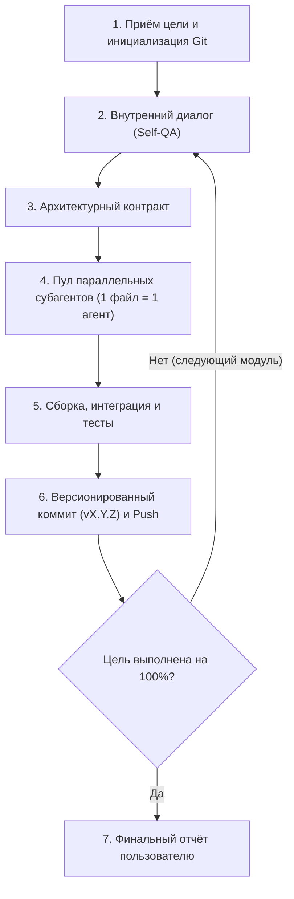

# GeminiAuto 🚀

> **Набор скиллов и автономный оркестратор задач для Google Antigravity**

[](https://antigravity.google)
[](https://github.com/VerlorenRise/GeminiAuto)
[](https://opensource.org/licenses/MIT)

**GeminiAuto** — репозиторий пользовательских скиллов для Google Antigravity, включающий автономный оркестратор разработки `/agent`, протокол изоляции субагентов, регламенты приватности Git/GitHub и стилистический фильтр контента.

---

## 📦 Включённые скиллы

| Скилл | Назначение |
| :--- | :--- |
| **`agent`** (`/agent`) | **Автономный оркестратор полного цикла**: Self-QA, параллельный запуск субагентов (1 файл = 1 агент), автоматическая сборка, тестирование, версионирование коммитов (`v0.0.1+`) и работа до 100% готовности. |
| **`github-rules`** | **Безопасность и правила Git/GitHub**: 100% приватность репозиториев (Private), обязательные проектные ветки, строгий формат коммитов (`vX.Y.Z`). |
| **`parallel-subagents`** | **Протокол многоагентной работы**: предварительное проектирование интерфейсов (контракт), изоляция файлов (1 агент = 1 файл) и финальная сборка главным координатором. |
| **`unslop`** | **Очистка текста**: удаление типичных AI-клише, "воды", шаблонных оборотов и неестественных конструкций. |

---

## 🌟 Ключевые возможности оркестратора (/agent)

- 🤖 **100% Автономность (No Interruptions)**: агент не отвлекает промежуточными вопросами, самостоятельно доводя задачу до полной готовности.
- 🧠 **Внутренний диалог (Self-QA)**: глубокий анализ архитектуры, интерфейсов, граничных случаев и тестов перед написанием кода.
- 📐 **Архитектурный контракт**: строгая фиксация DTO, сигнатур методов и путей файлов перед передачей субагентам.
- ⚡ **Параллельные субагенты (1 файл = 1 агент)**: строгая изоляция файлов, исключающая конфликты при генерации кода.
- 🛠️ **Автономная сборка и самоисправление**: самостоятельный запуск сборщиков (Maven, Gradle, npm и др.), анализ стек-трейсов и исправление ошибок.
- 🏷️ **Автоматическое версионирование коммитов**: каждый логический шаг фиксируется в формате `vX.Y.Z: <описание>` с непрерывным инкрементом от `v0.0.1` до `v9.9.9`.

---

## 🔄 Жизненный цикл оркестратора



---

## 📂 Структура репозитория

```
GeminiAuto/
├── SKILL.md                          # Корневой манифест скилла /agent
├── skills/
│   ├── agent/
│   │   └── SKILL.md                  # Скилл автономного оркестратора
│   ├── github-rules/
│   │   └── SKILL.md                  # Скилл правил работы с GitHub/Git
│   ├── parallel-subagents/
│   │   └── SKILL.md                  # Скилл протокола субагентов
│   └── unslop/
│       └── SKILL.md                  # Скилл удаления AI-паттернов и клише
├── LICENSE                           # Лицензия MIT
└── README.md                         # Документация и руководство
```

---

## 📥 Установка и использование

### Установка всех скиллов глобально
Скопируйте содержимое папки `skills/` в вашу директорию скиллов Antigravity:
- **Windows**: `%USERPROFILE%\.gemini\config\skills\`
- **Linux / macOS**: `~/.gemini/config/skills/`

### Установка в отдельный проект
Разместите нужные скиллы в проектной директории:
`.gemini/skills/<skill-name>/SKILL.md`

### Запуск оркестратора
В диалоге с Antigravity вызовите команду:
```text
/agent <описание задачи или проекта>
```

---

## 📜 Лицензия

Проект распространяется под лицензией [MIT](LICENSE).
