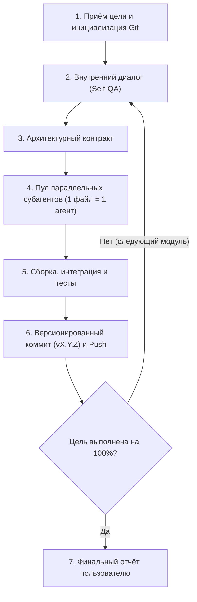

# Автономный оркестратор задач (/agent)

Этот скилл активируется по команде `/agent` и переводит работу в режим **100% автономности**. Пользователь задаёт высокоуровневую цель, а агент самостоятельно планирует, декомпозирует, запускает субагентов, проверяет код, создаёт коммиты и доводит проект до полной готовности.

---

## Ключевые принципы режима /agent

1. **100% автономность (No Interruptions)**:
   - В режиме `/agent` **не запрашивать у пользователя промежуточных разрешений** на создание веток, редактирование файлов, запуск команд, коммиты или вызовы субагентов.
   - Работать непрерывно до полного достижения поставленной цели.
2. **Безусловная приватность**:
   - Любой репозиторий и все ветки обязаны быть строго **Private**.
3. **Изолированная рабочая ветка**:
   - Вся работа ведётся в отдельной приватной ветке с названием проекта/задачи.
4. **Версионирование коммитов от v0.0.1 до v9.9.9**:
   - Формат каждого коммита: `vX.Y.Z: <Краткое понятное описание сделанного>`.
   - Нумерация строго возрастает: старт с `v0.0.1`, патч-инкремент на каждый завершенный шаг (`v0.0.2`, `v0.0.3`...), минорный инкремент при завершении крупного модуля (`v0.1.0`).
5. **Протокол субагентов (1 файл = 1 агент)**:
   - Всегда соблюдать протокол `/parallel-subagents`: жесткая изоляция файлов, предварительный контракт и финальная сборка главным агентом.

---

## Полный рабочий цикл оркестратора



---

### Фаза 1. Инициализация и подготовка Git
1. Определить имя проекта/задачи.
2. Проверить статус Git:
   - Убедиться, что репозиторий приватный.
   - Создать и переключиться на рабочую ветку с именем проекта (например, `git checkout -b <project-name>`), если ветка ещё не создана.
3. Определить текущую версию для коммитов (проверить историю `git log`; если коммитов с версией нет — стартовать с `v0.0.1`).

---

### Фаза 2. Внутренний диалог и саморефлексия (Self-QA)
Перед тем как писать хоть одну строчку кода или запускать субагентов, агент обязан задать самому себе следующие контрольные вопросы и зафиксировать ответы:
- **Архитектура**: *Какова структура модулей и какие зависимости (Maven/Gradle/npm/etc.) необходимы?*
- **Границы и файлы**: *Какие файлы должны быть созданы или изменены? Как распределить их на абсолютно независимые единицы?*
- **Интерфейсы и связи**: *Какие сигнатуры методов, DTO и контракты нужны, чтобы субагенты не сломали интеграцию?*
- **Краевые случаи и отказоустойчивость**: *Где возможны NullPointerException, гонки потоков, утечки ресурсов, некорректные входные данные?*
- **Критерии готовности**: *Какая команда или тест однозначно докажет работоспособность этого этапа?*

---

### Фаза 3. Фиксация архитектурного контракта
Оркестратор самостоятельно формулирует контракт:
- Полные пути к файлам.
- Точные имена классов, интерфейсов и перечислений.
- Сигнатуры всех публичных методов с типами параметров и возвращаемых значений.
- Структуры конфигурационных файлов (например, `pom.xml`, `plugin.yml`, `application.yml`).

---

### Фаза 4. Пул параллельных субагентов
1. Запускать субагентов строго параллельно через инструмент `invoke_subagent`.
2. **Жесткое правило: 1 файл = 1 субагент**.
   - Субагенту передаётся его закреплённый файл, утверждённый контракт и конкретная задача.
   - Двум субагентам категорически запрещено передавать один и тот же файл.
3. Типовые зоны ответственности субагентов:
   - Субагент A: Написание конкретного сервиса/класса по контракту.
   - Субагент B: Написание модели данных / репозитория.
   - Субагент C: Формирование файлов конфигурации и зависимостей.

---

### Фаза 5. Финальная сборка и верификация
Когда субагенты завершили генерацию файлов:
1. Главный агент лично читает созданные файлы, проверяет импорты и связывает их в главном классе приложения.
2. Запускает тестовую сборку или тесты (например, `mvn clean test`, `npm test`, сборка проекта).
3. **Автономное устранение ошибок**: если сборка падает с ошибкой, оркестратор сам анализирует стек-трейс, локализует причину и исправляет код, не обращаясь к пользователю.

---

### Фаза 6. Автоматический версионированный коммит
1. После успешной проверки каждого логического этапа оркестратор формирует коммит:
   ```bash
   git add .
   git commit -m "vX.Y.Z: Краткое описание реализованного функционала"
   git push origin <project-branch>
   ```
2. Инкремент версии:
   - `v0.0.1` -> `v0.0.2` -> `v0.0.3` (патч при добавлении компонентов/фиксов);
   - `v0.1.0` (минор при завершении крупной подсистемы).
3. Диапазон версий строго в пределах от `v0.0.1` до `v9.9.9`.

---

### Фаза 7. Итеративный переход к следующему модулю
1. Оркестратор сверяется с исходной целью:
   - Если цель требует создания следующих подсистем, сервисов или интерфейсов — оркестратор возвращается к **Фазе 2** (внутренний диалог) и проводит следующую итерацию.
2. Не останавливаться, пока вся задача не будет реализована и проверена.
3. **Финальный отчёт**: только когда цель полностью достигнута, предоставить пользователю структурированный отчет со списком созданных файлов, выполненных коммитов и результатами сборки.
